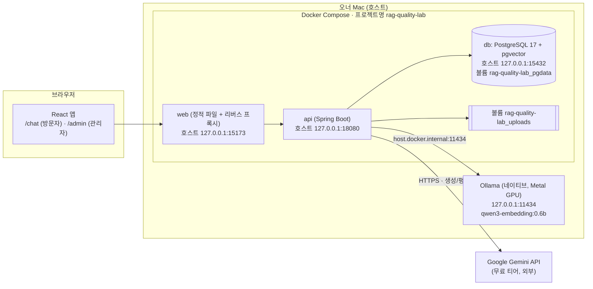
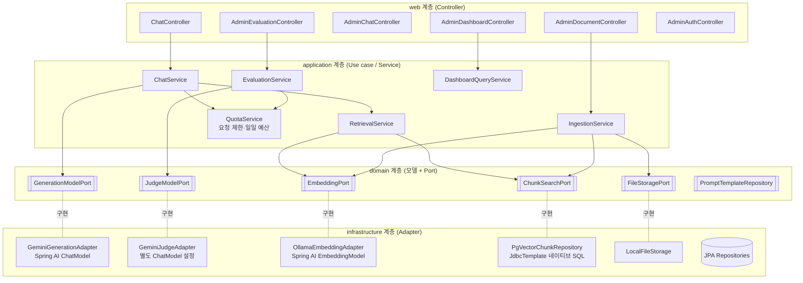
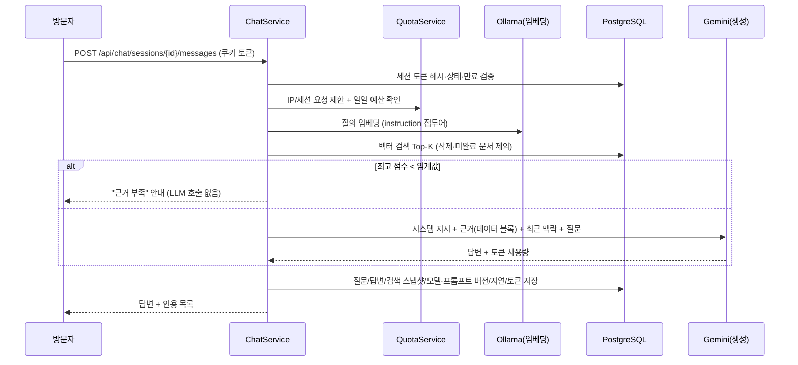

# 03. 아키텍처 설계 (제안)

## 1. 배포 구성 (로컬)



- **개발 모드:** DB만 Compose로 띄우고, API는 `./gradlew bootRun`(호스트), 프론트는 Vite dev 서버로 실행. 이때 API → Ollama는 `localhost:11434`.
- **데모 모드:** Compose로 web/api/db 전체 실행.
- 모든 호스트 포트는 `127.0.0.1`에만 바인딩 (LAN 노출 방지).

## 2. 백엔드 컴포넌트 (모듈형 모놀리스)



### 핵심 설계 결정
- **생성과 평가 분리:** `GenerationModelPort`와 `JudgeModelPort`는 별개 인터페이스, 별개 설정 블록(`app.llm.generation.*`, `app.llm.judge.*`), 별개 프롬프트 디렉터리. 같은 공급자여도 별도 `ChatModel` Bean.
- **벡터 검색은 자체 테이블:** Spring AI `VectorStore` 대신 `document_chunks` 테이블에 `vector(1024)` 컬럼 + HNSW 인덱스, 검색 SQL에서 `deleted_at IS NULL AND documents.status='READY'` 필터 (ADR-0005).
- **비동기 처리:** 인덱싱·평가는 `@Async` 전용 실행기(스레드 수 설정값). 상태는 DB가 진실 공급원. 기동 시 `PROCESSING/RUNNING` 잔존 건은 `FAILED(INTERRUPTED)`로 전환.
- **프롬프트 버전 관리:** `backend/src/main/resources/prompts/{generation|judge}/v{N}.md` 파일, 버전 문자열과 SHA-256을 메시지/평가에 기록.

## 3. 요청 흐름

### 3.1 질문 → 답변 (CHAT-03~06)

- 근거 부족 판정을 **LLM 호출 전에** 하여 무료 한도 소모를 줄인다. 임계값 이상이어도 모델이 "근거 없음"을 답할 수 있도록 프롬프트에 규칙 명시.

### 3.2 평가 (EVAL-01~05)
1. 관리자가 `POST /api/admin/evaluations {messageId}` → 중복 확인 → `PENDING` 저장 → `202 Accepted + evaluationId`.
2. 비동기 작업: `RUNNING` → 입력 스냅샷 구성(질문, 해당 답변 이전 맥락, 답변, **당시** `retrieval_records`, 루브릭 vN) → Judge 호출(구조화 JSON) → 스키마·점수 범위 검증 → 서버에서 총점 합산 → `COMPLETED`.
3. 실패: 타임아웃·429·스키마 불일치는 최대 재시도 1회(설정값) 후 `FAILED(error_code)`.

## 4. 폴더 구조 (제안)

```text
RAG-Quality-Lab/
├─ CLAUDE.md, PROJECT_SPEC.md, README.md
├─ compose.yaml                 # name: rag-quality-lab
├─ .env.example                 # 비밀값 없음, 포트·모델명 기본값
├─ backend/
│  ├─ build.gradle.kts, settings.gradle.kts, gradlew
│  └─ src/
│     ├─ main/java/com/ragqualitylab/
│     │  ├─ common/            # 오류 응답, 설정, 보안 공통
│     │  ├─ chat/              # web / application / domain / infrastructure
│     │  ├─ document/
│     │  ├─ retrieval/
│     │  ├─ evaluation/
│     │  ├─ admin/             # 인증, 대시보드
│     │  └─ llm/               # 포트 + Gemini/Ollama 어댑터, 사용량 기록
│     ├─ main/resources/
│     │  ├─ application.yml
│     │  ├─ db/migration/      # Flyway V1__init.sql …
│     │  └─ prompts/generation/v1.md, prompts/judge/v1.md, rubric/v1.yaml
│     └─ test/                 # unit / integration(Testcontainers) / external(@Tag("external"))
├─ frontend/
│  ├─ package.json, vite.config.ts
│  └─ src/ (pages/chat, pages/admin, api/, components/)
├─ knowledge/base/01_rest_api.md … 08_caching.md
├─ evaluation/golden_questions.jsonl
└─ docs/phase0/, docs/adr/
```

- 패키지는 **기능(모듈) 우선 + 내부 계층** 구조. 모듈 간 호출은 application 서비스 공개 메서드로만.
- 외부 API를 실제 호출하는 테스트는 `@Tag("external")`로 분리하고 기본 빌드에서 제외.

## 5. 주요 설정값 (기본값 제안)

| 키 | 기본값 | 설명 |
|---|---|---|
| `app.chunk.size-chars` / `overlap-chars` | 800 / 120 | 한국어 기준 문자 단위, Markdown 제목 경계 우선 분할 |
| `app.retrieval.top-k` | 5 | |
| `app.retrieval.min-score` | 0.45 (코사인 유사도) | Phase 2 골든셋으로 보정 |
| `app.chat.context-turns` / `max-context-tokens` | 6 / 2000 | |
| `app.chat.max-question-chars` | 1000 | |
| `app.chat.session.idle-timeout` / `max-lifetime` | 30m / 24h | |
| `app.llm.generation.model` / `max-output-tokens` / `timeout` | gemini-3.5-flash-lite / 1024 / 30s | |
| `app.llm.judge.model` / `max-output-tokens` / `timeout` | gemini-3.6-flash / 2048 / 60s | |
| `app.llm.max-retries` | 1 | 429/5xx에만 |
| `app.quota.daily-generation-calls` / `daily-judge-calls` | 오너 RPD 확인 후 결정 (잠정 200 / 50) | 초과 시 fail closed |
| `app.quota.per-ip-per-minute` / `per-session-per-minute` | 10 / 5 | |
| `app.retention.chat-days` / `deleted-file-days` | 90 / 30 | |
| `app.upload.max-bytes` | 10MB | |
