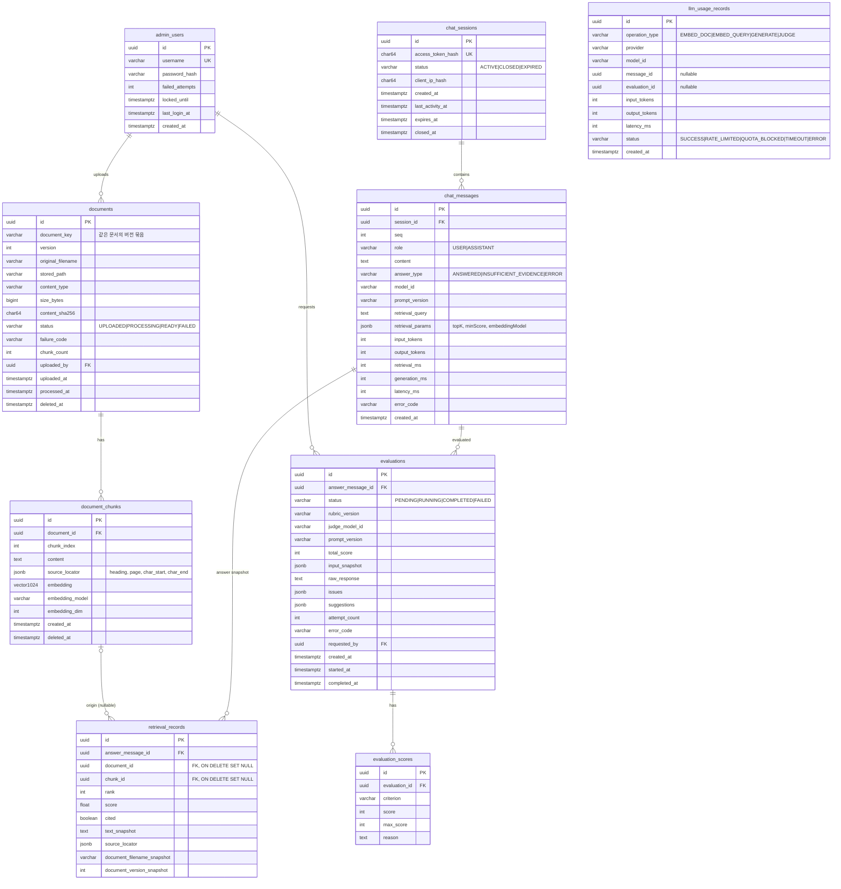

# 04. ERD 초안

- 기준: `PROJECT_SPEC.md` 7절 + `00` 문서 R4~R6, R13, R14 반영
- PK는 `uuid`(애플리케이션에서 UUIDv7 생성, 정렬성 확보). 시각은 `timestamptz`.
- 이 문서는 설계안이며, 마이그레이션은 Phase 1 승인 후 Flyway로 작성한다.

## 1. 제약조건·인덱스

| 테이블 | 제약/인덱스 | 목적 |
|---|---|---|
| documents | `UNIQUE(document_key, version)`; 부분 인덱스 `(status) WHERE deleted_at IS NULL` | 버전 무결성, 검색 대상 필터 |
| document_chunks | `UNIQUE(document_id, chunk_index)`; **HNSW `(embedding vector_cosine_ops)`**; `(document_id)` | 벡터 검색, 삭제 처리 |
| chat_sessions | `UNIQUE(access_token_hash)`; `(status, last_activity_at)` | 토큰 조회, 만료 스캔 |
| chat_messages | `UNIQUE(session_id, seq)`; `(created_at)` | 순서 보장, 기간 필터 |
| retrieval_records | `(answer_message_id, rank)` | 스냅샷 조회 |
| evaluations | `(answer_message_id, created_at DESC)`; **부분 유니크 `(answer_message_id) WHERE status IN ('PENDING','RUNNING')`** | 이력 조회, 동시 중복 평가 방지(DB 수준) |
| evaluation_scores | `UNIQUE(evaluation_id, criterion)`, `CHECK(score BETWEEN 0 AND max_score)` | 점수 범위 |
| llm_usage_records | `(operation_type, created_at)` | 일일 예산 집계 |

- HNSW 인덱스는 삭제 필터와 함께 쓰면 결과 수가 줄 수 있다(필터가 인덱스 탐색 후 적용). pgvector 0.8의 반복 인덱스 스캔(`hnsw.iterative_scan`) 사용을 Phase 2에서 검증한다. 데이터가 적은 MVP에서는 정확 검색(인덱스 미사용)도 허용 가능.

## 2. 삭제·보존 정책

| 대상 | 동작 | 시점 |
|---|---|---|
| 문서 삭제(DOC-05) | `documents.deleted_at`, `document_chunks.deleted_at` 설정 → **같은 트랜잭션에서 즉시 검색 제외** | 즉시 |
| 원본 파일 | 물리 삭제 | 삭제 후 30일 (설정값) |
| 청크 행·벡터 | 물리 삭제 (`retrieval_records`는 `SET NULL`, 스냅샷 텍스트는 유지) | 삭제 후 30일 |
| 대화 세션·메시지·검색 스냅샷·평가 | 세션 단위로 함께 물리 삭제 | 생성 후 90일 (설정값) |
| 사용량 기록 | 집계 후 유지 (개인 식별 정보 없음) | 무기한(설정 가능) |

- 동일 문서의 새 버전 업로드 시 이전 버전은 삭제 처리되지만, 과거 답변의 `retrieval_records.text_snapshot`으로 **평가 재현성 유지**.

## 3. 개인정보 최소화
- 방문자 IP는 원문 저장 금지, **솔트(환경변수) + SHA-256 해시**만 저장(남용 추적용).
- User-Agent 등 추가 식별정보 미수집.
- 방문자 질문 원문은 저장되므로 UI에 저장 사실·보관 기간 고지(9절 개인정보).

## 4. 동시성
- 평가 중복: 부분 유니크 인덱스 위반 → `409`.
- 메시지 순서: 세션 행 `SELECT … FOR UPDATE`로 같은 세션 동시 질문 직렬화(또는 진행 중이면 `409 MESSAGE_IN_PROGRESS`).
- 문서 처리 재시도: 상태 전이를 조건부 UPDATE(`WHERE status = 'FAILED'`)로 수행.
